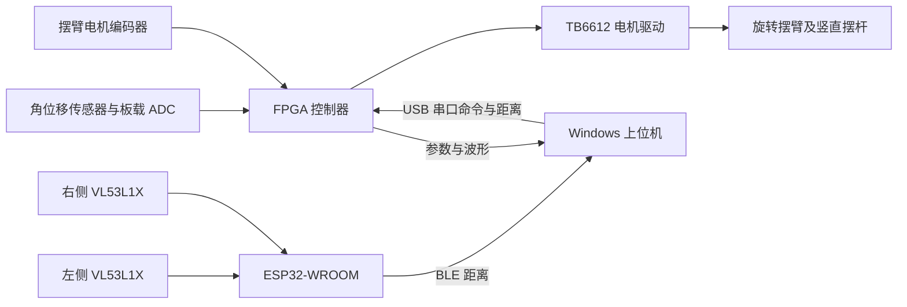

# FPGA 倒立摆

基于高云 J280 开发板的旋转倒立摆比赛项目。FPGA 负责角度采集、编码器反馈、自动起摆、平衡控制及运动控制；ESP32-WROOM 读取两路 VL53L1X 距离，通过 BLE 发送到电脑；Windows 上位机完成参数配置、波形观测、轨迹下发及距离转发。

本仓库是 **REV25 的比赛交付整理版**，源码来自 [Clone340/FPGA 的 KA.10.29 分支](https://github.com/Clone340/FPGA/tree/KA.10.29/fpga)，固定提交 `ef02e1dc3b3b0534aa8e8dad9988b455389c028f`。上游发布为 [KA.11.01-REV25](https://github.com/Clone340/FPGA/releases/tag/KA.11.01-REV25)。本次整理保留该提交的控制算法、默认参数、引脚和通信协议，不混用其他同名 REV25 试验版本。

## 下载与版本对应

请到本仓库的 [Releases](https://github.com/Karcious/FPGA-Inverted-Pendulum/releases) 下载成品。Git 仓库保存源码、约束、必要测试和构建脚本；可执行程序和固件只放在 Release。

| 文件 | 用途 | 来源 |
| --- | --- | --- |
| `FPGA-Balance-Studio-REV25-Windows-x64.zip` | Windows 上位机，完整解压后运行 EXE | 上游 REV25 程序及运行库，移除历代说明和旧参数，补入本说明；EXE 保持原样 |
| `FPGA-REV25.fs` | J280 FPGA 位流 | 上游 REV25 `.fs`，逐字节保留；SHA-256 以 Release 校验文件为准 |
| `ESP32-TOF-v1.2-Firmware.zip` | ESP32-WROOM 烧录包，包含启动程序、分区表、应用和脚本 | 从同版 v1.2 源码重新编译；本轮未烧录验收 |
| `SHA256SUMS.txt` | 文件完整性校验 | 本次交付包的 SHA-256 |
| `release_manifest.json` | 源提交、上游附件、本次文件与验证结果的对应关系 | 本次交付记录 |

FPGA 参数 0 应读回 **`0x00020719`**；`ping` 只返回协议版本 **`0x0207`**，不能单独区分小版本。主参数表共 **52 项（0～51）**。ESP32 的 20 字节 BLE 协议仍为 **v1**，与固件源码版本 v1.2 是两个概念。

## 系统组成与功能



- 自动起摆、捕获与竖直平衡；也支持手扶至竖直附近后进入闭环。
- 角度内环 PD、摆臂位置外环 PID；内环支持保守模糊增益调度，默认开启。
- 角度采样滤波、微分滤波、摩擦补偿、PWM 限幅、换向消隐以及故障状态记录。
- 板载按键、远程左右 90°、指定角度/长距离走位、转速控制和自定义速度曲线。
- 静稳抑制：满足静止条件后暂时抑制驱动，检测角度趋势或编码器运动后唤醒。
- BLE 测距显示与距离转发；FPGA 在允许平衡运动的状态下按距离调整退避速度。
- 实时波形、完整窗口采集、参数 JSON / 波形 CSV 导出、内环实际增益显示与离线演示。

本项目没有将限时倾角实验、竖直摆杆端点往复实验作为交付功能。正常平衡、走位和避障仍需根据实际负载、供电和机械状态进行验收。

## 目录

```text
fpga/
  pendulum.gprj              Gowin 工程文件
  src/common/               CRC、UART 收发
  src/control/              控制器、起摆、轨迹、按键、静稳及测距接收
  src/debug/                参数寄存器、串口协议、采集缓存
  src/fpga_project.sdc       50 MHz 时钟约束
  scripts/                  Gowin 构建、ModelSim/Icarus 回归、模糊数值模型
  tests/                    RTL 测试台及必要回放输入
ESP32/
  tof_ble/                  Arduino 工程和 VL53L1X 驱动、许可证
  scripts/                  编译、烧录、驱动测试入口
  tests/                    I2C 正常与故障注入测试
上位机/
  src/                      界面、串口工具、蓝牙接收、轨迹和统计
  assets/                   图标
  tests/                    离线自动测试
  requirements.txt          固定版本依赖
  build.py                  Windows 可执行程序打包
  run_tests.py              上位机回归入口
readme.md                   项目介绍、接线、烧录、使用与已知限制
```

根目录另有 `.gitignore`、`.gitattributes`，用于排除构建缓存及统一文本格式。旧日志、个人采集记录、历史 `.md`、旧固件、旧上位机、虚拟环境和编译中间文件不纳入版本库。测试用的 `swing_fault_replay.hex` 是实际测试依赖，不是可删除的编译缓存。

### 核心代码分工

| 模块 | 作用 |
| --- | --- |
| `pend_top.v` | 连接采集、控制、保护、轨迹与通信，仲裁电机输出 |
| `adc_capture.v` / `encoder_decode.v` | 角度采集与编码器解码 |
| `pid_q16.v` / `fuzzy_pid_q16.v` | Q16.16 定点控制、微分滤波与模糊增益调度 |
| `position_feedback.v` | 位置坐标、角度折返与移动结束后的坐标重置 |
| `swing_once.v` | 自动起摆、捕获、确认平衡及故障处理 |
| `key_motion_target.v` | 按键/远程走位、准备和停靠状态 |
| `spin_trajectory.v` | 速度轨迹、暂停、停止及避障运动接管 |
| `quiet_guard.v` | 静止驱动抑制与趋势唤醒 |
| `tof_receiver.v` | 距离帧提交、新鲜度、退避触发和距离到速度的映射 |
| `param_regs.v` / `dbg_proto.v` | 参数表与串口读写协议 |
| `tof_ble.ino` | 两路独立 I2C 测距、重试、BLE 广播与通知 |
| `fpga_console.py` / `dbg_host.py` | 桌面主界面和串口客户端 |
| `gui_tof.py` / `gui_features.py` | BLE 接收、距离校验、串口转发及避障配置 |
| `gui_motion.py` / `gui_trajectory.py` / `gui_wave.py` | 走位、速度曲线、波形运动操作 |

## 硬件与接线

### FPGA 主控

目标开发板：**Gowin J280**；器件：**GW2A-LV55PG484C8/I7，器件版本 C**；板载时钟 50 MHz。电机使用板上的 TB6612 B 通道，默认 `MOTOR_EN=2`；PWM 20 kHz。角度使用板载外部 ADC，编码器采用 A/B 两相输入。以下为工程约束中的 FPGA 球位，不是 ESP32 引脚。

| 信号 | FPGA 球位 | 电平 |
| --- | --- | --- |
| 系统时钟 | M19 | 3.3 V |
| SW5 / 低有效复位 | AB3 | 3.3 V |
| SW1 / SW2 / SW3 / SW4 | T18 / R18 / U20 / T20 | **1.5 V** |
| UART TX / RX | K20 / L20 | 3.3 V |
| 电机 B PWM / BN1 / BN2 | V14 / AA17 / V15 | 3.3 V |
| 编码器 A / B | Y20 / AA20 | 3.3 V |
| ADC CLK / OE / OTR | G18 / H20 / F18 | 3.3 V |
| ADC D0～D9 | L21, M21, J20, J19, D19, H18, H19, G19, G17, E19 | 3.3 V |
| LED1～LED4 | U18 / U19 / U17 / T17 | 1.5 V |

完整约束见 `fpga/src/control/pend_top.cst`。SW3/SW4 使用 SSPI 复用脚，构建必须启用 `use_sspi_as_gpio=1`。不可将这些 1.5 V 按键脚当成 3.3 V 扩展接口使用。电机和驱动板按 J280/IP570 硬件供电要求接线；ESP32 不给电机供电。

### ESP32-WROOM 与两路 VL53L1X

两颗传感器使用**两条独立 I2C 总线**，可保持各自默认地址 `0x29`；INT 由本程序轮询替代，无需接线。

| VL53L1X 引脚 | 第一路 | 第二路 |
| --- | --- | --- |
| SDA | GPIO21 | GPIO25 |
| SCL | GPIO22 | GPIO26 |
| SHUT / XSHUT | GPIO32 | GPIO33 |
| GND | ESP32 GND | ESP32 GND |
| VCC | 已验证模块使用 3V3；以具体模块规格为准 | 同左 |
| INT | 不接 | 不接 |

GPIO 为 ESP32 芯片编号，不是排针序号。I2C 频率 100 kHz。当前程序将 XSHUT 配置为推挽输出高/低；使用其他裸芯片或模块时，先确认其 XSHUT 输入是否允许 ESP32 的 3.3 V 电平，否则需要电平转换。两路 GND 必须与 ESP32 共地。

ESP32 可用独立电源随摆臂运动；电源应满足开发板的输入要求，不可将单节锂电池直接接到 3V3。BLE 桥接方案不需要从运动臂再拉一组 SPI/串口线到 FPGA。模块安装后会改变惯量与重心，不能保证原 PID 在所有负载下效果相同。

## 编译与烧录

### 直接使用 FPGA Release 固件

1. 下载 `FPGA-REV25.fs`，核对 `SHA256SUMS.txt`。
2. 连接 J280 下载器，打开 **Gowin Programmer**，扫描 JTAG 器件并确认型号与上述一致。
3. 选择该 `.fs`。临时测试使用 SRAM 下载；需要断电保存时，使用开发板对应的外置 Flash 编程模式，并核对 Flash 型号/配置，不能只下载到 SRAM。
4. 完成烧录后按 SW5 复位。上电默认为停止模式，不会直接驱动电机。
5. 用上位机读取参数 0、3、5、18、20、44：应分别为 `0x00020719`、`4.5`、`−1.2`、`3075`、`−40`、`−11`。已手动修改过运行参数时需区分运行值与上电默认值。

### 从源码构建 FPGA

已验证工具链为 **Gowin V1.9.12.03 x64**。在仓库根目录打开 PowerShell，按本机安装位置修改可执行文件路径：

```powershell
& "E:\Gowin\Gowin_V1.9.12.03_x64\IDE\bin\gw_sh.exe" .\fpga\scripts\build.tcl
```

输出为 `fpga/impl/pnr/project.fs`。`pendulum.gprj` 用于打开工程和查看源码；推荐用上述脚本构建，它明确设置 `pend_top`、SSPI 转 GPIO、50 MHz 约束、`place=1 / route=1 / max_fanout=40`。在 Designer 内直接编译时也必须设置同样选项。构建后检查报告中的错误、时序和实际 `.fs`，不能仅凭进程返回成功判断可烧录。

### 编译 ESP32

使用 Arduino IDE 2 或 Arduino CLI，安装 **esp32 by Espressif Systems 2.0.17**，板型选 **ESP32 Dev Module**（FQBN `esp32:esp32:esp32`）。打开 `ESP32/tof_ble/tof_ble.ino`，同目录已提供 VL53L1X 驱动，不要用其他版本覆盖。BLE/Wire 来自 ESP32 core。

CLI 示例，在仓库根目录执行：

```powershell
arduino-cli core install esp32:esp32@2.0.17 --additional-urls https://espressif.github.io/arduino-esp32/package_esp32_index.json
arduino-cli compile --fqbn esp32:esp32:esp32 --output-dir .\ESP32\build .\ESP32\tof_ble
arduino-cli upload --fqbn esp32:esp32:esp32 --port COM7 --input-dir .\ESP32\build .\ESP32\tof_ble
```

`COM7` 只是示例，使用设备管理器中 ESP32 的实际端口。也可调用 `ESP32/scripts/build.ps1` 和 `flash.ps1 -Port COM7`；若 Arduino CLI 未在 PATH，传入 `-ArduinoCli` 指定路径；使用 Arduino IDE 的独立配置时可再传 `-ConfigFile`。上传失败并提示无法连接时，按开发板要求使用 BOOT/EN；烧录时关闭占用该串口的监视器。

Release ESP32 固件包内有 `flash.ps1`，使用包内的烧录地址组合。**应用程序 bin 不能单独写到地址 0**。串口诊断波特率 **115200**；上电应看到 BLE 初始化及传感器状态，广播名为 **`FPGA-ESP32-TOF`**。

### 运行和构建上位机

成品包解压后运行目录中的 EXE，保留 `_internal` 和许可证目录，不要只复制 EXE。电脑需要正常工作的蓝牙适配器及 FPGA USB 串口驱动。

源码运行建议 Python **3.12 x64**：

```powershell
python -m venv .\上位机\.venv
& .\上位机\.venv\Scripts\python.exe -m pip install -r .\上位机\requirements.txt
& .\上位机\.venv\Scripts\python.exe .\上位机\src\fpga_console.py
```

离线查看加 `--demo`。打包使用：

```powershell
& .\上位机\.venv\Scripts\python.exe .\上位机\build.py
```

输出在 `上位机/dist/`。脚本只打包本版程序、运行依赖、许可证和根目录说明，不再复制旧参数或历代文档。重复构建前先将上一次成品移走，脚本不会覆盖已有发布目录。

## 使用流程

### 起摆和平衡

1. 检查机械连接、线缆和摆臂可运动空间，竖直摆杆自然下垂，供电稳定。
2. 上位机选择 FPGA 的实际串口，点击连接；FPGA 波特率 **460800**。ESP32 的 USB 串口不是 FPGA 的端口。
3. 核对版本与零点。默认 `CENTER_ANGLE=3075` 是原装置的标定值，换传感器或装配后需重新测量；它不同于摆臂位置零点。
4. 按一次 **SW1**，或在上位机设置运行模式为自动起摆（`set 16 3`）。FPGA 自动执行起摆、捕获和闭环平衡。
5. 等状态显示“确认平衡”后再执行走位、轨迹或避障。手动起摆使用 `set 16 2`，扶杆到竖直附近后交给闭环。
6. 结束时点击“停止电机”或写 `set 16 0`。SW1 可切回停止；SW5 是全板复位。**关闭上位机窗口或断开串口并不等于电机已经停止。**

### 按键和移动

| 控件 | 功能 |
| --- | --- |
| SW1 | 停止/自动起摆切换 |
| SW2 | 逆时针 90°请求 |
| SW3 长按约 2 秒 | 标定当前摆臂位置零点，需满足状态条件 |
| SW4 | 顺时针 90°请求 |
| SW5 | 硬件复位 |

方向以原装置电机和编码器接线为准；改变接线后先确认方向。上位机还提供指定角度、长距离走位、转圈和曲线运动。运动结束后按对应控制流程以实际停靠位置重定零点。不要同时让多种功能争用轨迹控制；先停止当前运动并确认停稳。

速度曲线 `v(t)` 的单位为 °/s，`t` 为轨迹时间、`T` 为设置的总时间。先检查/预览，再上传运行；持续运行按所设周期循环。平衡优先时可能暂停轨迹计时，因此实际运行总时长可能超过 `T`。输入曲线的限制和板上加速度、速度限制共同决定实际运动，预览图不等于实测跟踪结果。

### 静稳抑制

默认启用（地址 88=1）；静止等待 1000 ms（89），趋势阈值 11 个角度码（90，约 0.97°）。满足编码器静止、小角度和窗口稳定条件后才屏蔽驱动。检测到编码器运动、同方向角度连续增大或大偏角时重新开放控制。

它不是“彻底关闭平衡算法”，也不能保证摆杆达到理想物理平衡。需要比较正常控制时可在静稳页关闭，或写 `set 88 0`。阈值过大会延后恢复；改变阈值时先关闭该功能、设置后再启用。

### 蓝牙测距与退避

1. 给 ESP32 和传感器供电；在上位机“蓝牙测距”区域连接 `FPGA-ESP32-TOF`。这是 BLE 通知连接，不通过 Windows 蓝牙虚拟 COM 口传距离。
2. 检查左右距离、模块在线状态和数据年龄。遮挡传感器前方确认其读数随距离变化。
3. FPGA 先进入确认平衡，再选择左侧、右侧或双侧输入，启用距离转发/避障。
4. 有效距离 **小于 60 mm** 时请求退避；**大于 90 mm 连续约 200 ms** 后退出退避并停稳，再继续检测。无效/过期数据不会被当成有效近距离目标。
5. FPGA 根据距离映射速度，越近请求越快，仍由运动及平衡控制约束。默认方向为逆时针，可用“反转退避方向”切换；务必用低风险的小范围测试确认实际方向。
6. 结束时关闭避障并等停稳，再停止电机。通信中断时不能仅依据电脑旧读数判断电机状态。

**双侧选择的实际含义：**上位机选择两路中较近的有效距离交给同一个 FPGA 退避通道；左右共用方向开关，尚未按障碍物所在侧自动选择相反转向。单侧退避是现版明确实现的控制能力。

常见测距状态：`0` 表示有效；`254` 表示读失败或数据陈旧；`255`/未初始化表示模块尚未成功启动。无目标等其他状态也不能作为有效距离。先查供电、地线、SDA/SCL/XSHUT，再查 115200 串口诊断，不能把状态码当作毫米值。

## 参数和通信

串口 CLI 使用前先在上位机断开同一端口，避免抢占：

```powershell
python .\上位机\src\dbg_host.py --port COM10 get 0
python .\上位机\src\dbg_host.py --port COM10 dump
python .\上位机\src\dbg_host.py --port COM10 get 31
python .\上位机\src\dbg_host.py --port COM10 set 16 0
```

`COM10` 为示例。`set` 是运行时修改，复位/掉电会恢复 FPGA 编译默认值。普通 Q16.16 参数在 CLI/界面中直接输入小数，Python `set_param` 接口接收原始 32 位整数。**地址 47 是现版例外，见“审核结果”。**

扩展地址不是普通参数数组：64～79 负责轨迹、走位命令和状态，80～87 为测距接收与避障，88～91 为静稳抑制。部分地址可写，部分只读；不能将整个扩展区按“全部只读”或“全部可写”处理。测距必须先写 81/82/84，再写 83 序号完成一帧提交。

BLE 每包 20 字节、小端序：`TF` 标识、协议版本、模块在线位、序号、设备毫秒时间、左右距离各 16 位、左右状态各 8 位、保留字。服务 UUID 为 `6e400001-b5a3-f393-e0a9-e50e24dcca9e`，通知 UUID 为 `6e400003-b5a3-f393-e0a9-e50e24dcca9e`。PC 转发最高约 10 Hz；测距、BLE、PC 调度及串口均有延时，不应将其当作实时安全传感器链路。

### 主参数上电默认值

下表从本次固定提交的 `param_regs.v` 提取。0、1、2、31 在上位机按只读处理；31 为动态状态。Q16 小数有量化误差，括号中原始值可用于精确核对。

| 地址 | 名称 | 功能 | 默认值 | 原始值 |
| ---: | --- | --- | ---: | --- |
| 0 | `MAGIC` | 固件标识 | 0x00020719 | `0x00020719` |
| 1 | `CTRL_HZ` | 控制基准频率 | 1000 | `0x000003E8` |
| 2 | `PWM_HZ` | PWM 频率 | 20000 | `0x00004E20` |
| 3 | `KP_BAL` | 内环 P | 4.5 | `0x00048000` |
| 4 | `KD_BAL` | 内环 D | 120 | `0x00780000` |
| 5 | `KP_ARM` | 外环 P | -1.199997 | `0xFFFECCCD` |
| 6 | `KI_ARM` | 外环 I | -0.014999 | `0xFFFFFC29` |
| 7 | `THETA_SWITCH` | 捕获角度阈值 | 30 | `0x0000001E` |
| 8 | `OMEGA_SWITCH` | 捕获角速度阈值 | 600 | `0x00000258` |
| 9 | `FILT_SEL` | 微分滤波位掩码 | 271 | `0x0000010F` |
| 10 | `DUTY_MIN` | 摩擦补偿幅度 | 130 | `0x00000082` |
| 11 | `DUTY_MAX` | 输出限幅 | 1024 | `0x00000400` |
| 12 | `SWING_KP` | 起摆位置 P | 4 | `0x00040000` |
| 13 | `TARGET_POS` | 摆臂目标位置 | 0 | `0x00000000` |
| 14 | `SWING_KD` | 起摆位置 D | 1.600006 | `0x0001999A` |
| 15 | `TRIM_THETA` | 传感器偏移 | 135 | `0x00000087` |
| 16 | `OPENLOOP` | 运行模式 | 0 | `0x00000000` |
| 17 | `DUTY_TEST` | 开环输出 | 0 | `0x00000000` |
| 18 | `CENTER_ANGLE` | 竖直目标码 | 3075 | `0x00000C03` |
| 19 | `MOTOR_EN` | 电机使能位掩码 | 2 | `0x00000002` |
| 20 | `KD_ARM` | 外环 D | -40 | `0xFFD80000` |
| 21 | `CAPTURE_LOG2` | 采集降采样指数 | 0 | `0x00000000` |
| 22 | `FRICTION_MODE` | 摩擦补偿模式 | 0 | `0x00000000` |
| 23 | `MOVING_COMP` | 运动摩擦补偿 | 50 | `0x00000032` |
| 24 | `SWING_DUTY` | 起摆驱动 | -900 | `0xFFFFFC7C` |
| 25 | `SWING_MS` | 起摆时长 | 600 | `0x00000258` |
| 26 | `SWING_TIMEOUT` | 起摆超时 | 1500 | `0x000005DC` |
| 27 | `SWING_TRAVEL` | 起摆行程上限 | 520 | `0x00000208` |
| 28 | `HANG_ANGLE` | 下垂角度码 | 1017 | `0x000003F9` |
| 29 | `SWING_TARGET` | 起摆目标位置 | 350 | `0x0000015E` |
| 30 | `CAPTURE_MS` | 捕获确认时长 | 55 | `0x00000037` |
| 31 | `STATUS` | 运行状态 | 动态状态 | `0x00000000` |
| 32 | `WAITUP_BRAKE` | 起摆刹车增益 | 0 | `0x00000000` |
| 33 | `GAIN_A_KP` | A 段外环 P | -1.199997 | `0xFFFECCCD` |
| 34 | `GAIN_A_KD` | A 段外环 D | -40 | `0xFFD80000` |
| 35 | `GAIN_B_KP` | B 段外环 P | -1.199997 | `0xFFFECCCD` |
| 36 | `GAIN_B_KD` | B 段外环 D | -40 | `0xFFD80000` |
| 37 | `PHASE_A_MS` | A 段时长 | 0 | `0x00000000` |
| 38 | `PHASE_B_MS` | B 段时长 | 0 | `0x00000000` |
| 39 | `SETTLE_DAMP` | 下垂按停阻尼 | 2 | `0x00020000` |
| 40 | `MOVE_SLEW` | 走位斜坡 | 0.199997 | `0x00003333` |
| 41 | `PROF_SLEW` | 轨迹斜坡上限 | 0.057785 | `0x00000ECB` |
| 42 | `MOVE_ACC` | 斜坡加速度限 | 0.001495 | `0x00000062` |
| 43 | `SPIN_W` | 转速给定 | 0 | `0x00000000` |
| 44 | `SPIN_KP` | 速度环 P | -11 | `0xFFF50000` |
| 45 | `SPIN_KI` | 速度环 I | 0 | `0x00000000` |
| 46 | `SPIN_ACC` | 转速软启动 | 4 | `0x00000004` |
| 47 | `HOME_RAMP` | 回家限速 | 0.25 | `0x00004000` |
| 48 | `ARM_MAX` | 回正力上限 | 0 | `0x00000000` |
| 49 | `MOVE_DEC` | 走位减速度 | 0.000458 | `0x0000001E` |
| 50 | `COMP_SHIFT` | 死区补偿形状 | 1 | `0x00000001` |
| 51 | `TRAVEL_FOLLOW` | 走位绳子长度 | 0 | `0x00000000` |

## 验证与审核结果

本次整理对 RTL / ESP32 代码去注释前后的有效代码标记进行核对，对上位机 Python 代码进行去文档字符串及 QSS 样式注释后的 AST 核对；运行逻辑和默认参数保持上游版本。构建脚本、测试路径、交付文档和已过期的测试期望单独调整。

- **RTL：59/59 测试台通过**（ModelSim），包括起摆、捕获、轨迹停止/重定零点、静稳、测距、CRC/串口和参数默认值。
- **上位机：169 项离线测试通过，96 项协议检查通过**；RTL 实时遥测回放通过，源码打包入口执行成功（PyInstaller 6.13.0）；源码界面和待发布原版 EXE 均离线启动并截图检查通过。
- **ESP32：I2C 故障注入测试通过**；Arduino ESP32 core 2.0.17 编译通过，程序 1,133,957 / 1,310,720 字节，全局变量 39,524 / 327,680 字节。
- **FPGA：Gowin V1.9.12.03 重新综合、布局布线并生成位流**；下述时序结果来自本次清理后源码。Release 提供已核对哈希的上游成品位流。
- **代码等价性：41 个运行源码文件核对通过**，ESP32 Release 源码与固定 Git 提交仅换行格式不同。
- 本轮没有操作实际电机、串口或烧录硬件；上述结果属于构建、仿真和离线验证。

保留的已知问题和限制：

1. **地址 47 的上位机类型/范围不一致。** 固件使用 Q16.16 码/ms，默认原始值 16384，即 0.25；现版 GUI/CLI 仍按整数 duty/25ms 处理，GUI 范围 0～8191。不要用这一格的小数输入或 GUI 全量写入来恢复默认。需要写默认原始值时可用 `DbgLink.set_param(47, 16384)`，且先确认设备状态。此次未改变其行为，以保持原 Release 兼容。
2. **双侧自动选择退避方向尚未实现。** 当前是两路测量、择近输入、共用退避方向；不能宣称完整双向智能避障。
3. **离线演示不是板上参数的权威来源。** `DemoLink` 的 A/B 段参数仍保留旧值；实际以板上回读和本表为准。
4. **时序余量较小。** 50 MHz 下重新构建 Fmax 为 50.190 MHz，最差 setup slack 0.076 ns；setup/hold 违例 0/0。后续任何 RTL 或工具配置变化都要重新检查报告。
5. **约束与综合警告仍需后续专项审核。** 当前 SDC 仅设置系统时钟；外部 ADC 接口没有完整输入/输出时序预算。存在位宽截断和未连接调试/未启用 D 分支端口的原有警告；此次未把“能编译”解释为所有电气时序均已证明。
6. **机械稳态和运动平滑性仍受负载影响。** 增加 ESP32、传感器、打印件后惯量与摩擦改变；仿真通过不等于真实装置的低频振荡已消除。
7. **避障速度换算存在小幅比例差。** `tof_receiver.v` 使用每 °/s 对应 197 个 Q16 码/ms，而上位机使用 1040 编码器码/圈，对应约 189.33；标称退避速度会有约 4% 的比例差，仍需按实测验证。
8. **ESP32 新编译包需硬件复验。** 正常 I2C、短读、NACK 和非法时序输入已做离线测试；本轮没有连接或烧录装置，也未重新验收两路实测距离、供电与退避方向。

### 运行自动测试

推荐使用 ModelSim，并将 `SIMDIR` 设为其可执行文件目录：

```powershell
$env:SIMDIR = 'D:\modelsim\modelsim_ase\win32aloem'
python .\fpga\scripts\run_modelsim.py
& .\上位机\.venv\Scripts\python.exe .\上位机\run_tests.py
& .\ESP32\scripts\run_tests.ps1 -Compiler g++
```

FPGA 测试输出在 `fpga/build/tests`，每个协议测试的回放文件分开保存。上位机回放应在 FPGA 仿真完成后运行，不使用旧日志当作新测试数据。也提供 Icarus Verilog 入口 `fpga/scripts/run_tests.py`，通过 `IVERILOG_BIN` 指定工具目录；长时间模型测试可能需要提高 `--timeout`。

## 交付范围与来源

仓库包含可编译源码、引脚与时钟约束、离线测试、构建/烧录入口和使用说明。没有纳入私人调参日志、串口采集数据、旧发布包及机器专用缓存。

尚需团队补充的比赛材料：最终实物照片或演示视频、实际安装后的接线图/BOM、3D 打印件 CAD/STL、最终带载验收记录，以及适用的赛事说明或展示材料。本仓库已有控制板引脚信息，但这些资料不能由软件源码替代。

本仓库保留上游项目来源；VL53L1X 驱动的 STMicroelectronics / Pololu 许可证位于 `ESP32/tof_ble/LICENSE.txt`，分发固件也携带该许可证。Windows 包保留 Qt/PySide6、pyserial、PyInstaller、Bleak 等第三方许可信息。项目原创部分暂未另行选择开源许可证；公开仓库本身不等于为第三方代码重新授权。
